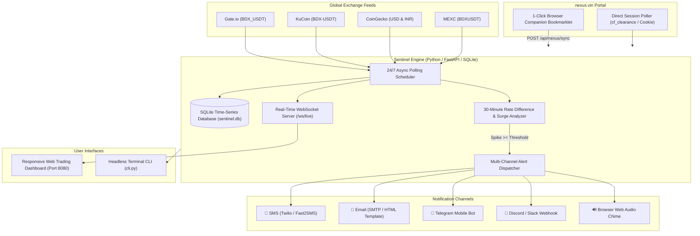

# 🛡️ Beldex Nexus Rate Sentinel

[](https://www.python.org/)
[](https://fastapi.tiangolo.com/)
[](#cross-platform-installation--usage)
[-brightgreen.svg)](#automated-testing)

An autonomous, cross-platform cryptocurrency monitoring and high-demand selling alert platform designed specifically for **Beldex (BDX)** and **nexus.vin** traders.

It continuously tracks live market prices across global exchanges (Gate.io, KuCoin, MEXC, CoinGecko), calculates exact **30-minute rolling rate differences**, monitors **nexus.vin**, and instantly dispatches **multi-channel alerts via SMS, Email, Telegram, Discord, and Web Audio chimes** whenever high price demand is detected so you can liquidate or sell your coins at peak value.

---

## 🌟 Key Features

1. **30-Minute Rate Difference & Demand Detection Engine**:
   - Computes rolling 30-minute absolute difference ($\Delta P = P_{\text{now}} - P_{\text{30m\_ago}}$) and percentage change ($\% \Delta$).
   - Multi-window matrix: 5m, 15m, 30m, 1h, and 24h intervals.
   - Evaluates high price demand spikes against your configurable threshold (e.g., $+3.0\%$, $+5.0\%$, $+10.0\%$).
   - Flags actionable signals: `"STRONG SELL OPPORTUNITY"`, `"TARGET SELL PRICE REACHED"`, `"HIGH DEMAND DETECTED"`.

2. **nexus.vin Integration & Arbitrage**:
   - **1-Click Browser Companion Bookmarklet**: Since `nexus.vin` uses Cloudflare Turnstile protection, the companion bookmarklet allows you to click once in your logged-in browser tab to relay authenticated live rates directly to your Sentinel dashboard!
   - **Direct Session Poller**: Supports passing session cookies (`cf_clearance`, `PHPSESSID`) or Bearer tokens.
   - **Arbitrage Calculator**: Quantifies the price spread between `nexus.vin` and global exchanges (e.g. `+5.4% Premium on Nexus!`).

3. **Multi-Channel Selling Alert System**:
   - **SMS Notifications**: Native integration with Twilio and Fast2SMS (ideal for Indian mobile numbers) or generic SMS Webhooks.
   - **Email Notifications**: Rich HTML templates with coin graphics, price tables, 30m profit gains, and one-click sell links.
   - **Telegram Bot**: Instant mobile push notifications with formatted Markdown tables and high-priority sound.
   - **Discord & Webhooks**: Rich color-coded embeds for community or channel notifications.
   - **In-App Web Audio Chimes**: Synthesizes audible trading fanfares directly in your browser when a spike occurs.
   - **1-Click Test Dispatcher**: Test and verify any notification channel with a single click before leaving it running.

4. **Portfolio Liquidation Calculator**:
   - Enter your Beldex holdings (e.g. `50,000 BDX`).
   - Computes real-time liquidation value in both **USD ($)** and **Indian Rupees (₹ INR)**.
   - Target price ladder shows prospective returns at current price, $+5\%$, $+10\%$, and $+25\%$ spikes.

5. **Cross-Platform Delivery**:
   - **Modern Web Dashboard**: Real-time dark-mode interface with Chart.js candlestick/trend graphs and WebSocket live feed.
   - **Terminal CLI**: Headless `cli.py` for Linux daemons, systemd services, SSH sessions, or Raspberry Pis.
   - **Cross-Platform Launchers**: `run.sh` (Linux/macOS), `run.bat` (Windows), and `docker-compose.yml`.

---

## 🏗️ Architecture Overview



---

## 🚀 Quick Start

### 1. Prerequisites
- Python 3.10, 3.11, 3.12, 3.13, or 3.14.
- Internet connection to query exchanges and dispatch alerts.

### 2. Linux / macOS
```bash
git clone <repository_url>
cd beldex-nexus-rate-sentinel

# Make script executable and launch
chmod +x run.sh
./run.sh
```
The application will automatically set up its virtual environment, install dependencies, initialize SQLite, and launch the web dashboard at **http://localhost:8080**.

### 3. Windows
Double-click `run.bat` or open Command Prompt:
```cmd
cd beldex-nexus-rate-sentinel
run.bat
```
The script will configure `venv`, install packages, and open the server on **http://localhost:8080**.

### 4. Docker & Docker Compose
```bash
docker compose up -d
```
Access the dashboard at **http://localhost:8080**.

---

## 🖥️ Command-Line Interface (CLI Mode)

For headless servers, background screen sessions, or quick terminal checks, use `cli.py`:

```bash
# Check current Beldex price, 30m difference, exchange breakdown, and selling signal:
./venv/bin/python3 cli.py status

# Run 24/7 continuous terminal monitor (polls every 30 seconds):
./venv/bin/python3 cli.py monitor --interval 30

# Test a notification channel directly from the CLI:
./venv/bin/python3 cli.py test-alert --channel telegram
./venv/bin/python3 cli.py test-alert --channel email
./venv/bin/python3 cli.py test-alert --channel sms
./venv/bin/python3 cli.py test-alert --channel discord

# Simulate a +7.5% 30-minute surge to test alerting:
./venv/bin/python3 cli.py simulate --surge 7.5

# Manually set or update the nexus.vin rate:
./venv/bin/python3 cli.py nexus-rate --usd 0.0760
```

---

## 🔗 How to Sync with nexus.vin

`nexus.vin` protects its web pages with Cloudflare Turnstile anti-bot checks. The Sentinel provides **three compliant methods** to capture live rates:

### Method A: 1-Click Browser Bookmarklet (Recommended)
1. Open the Sentinel dashboard at `http://localhost:8080`.
2. Click **Nexus Sync** on the top navigation bar.
3. Drag the **📌 Sync Nexus Rate** button into your browser's bookmarks bar (or click "Copy JavaScript Code" and save it as a bookmark URL).
4. In your browser, log in to **https://nexus.vin**.
5. Click your **📌 Sync Nexus Rate** bookmark.
6. The bookmarklet reads the current Beldex rate directly from your authenticated tab and securely transmits it to `http://localhost:8080/api/nexus/sync`. The dashboard immediately updates!

### Method B: Session Cookie Configuration
If you prefer automated polling:
1. Open Developer Tools (F12) on `https://nexus.vin` while logged in.
2. Copy your `Cookie` header string (including `cf_clearance` and session tokens).
3. Paste it in `.env` under `NEXUS_COOKIE="..."` or enter it via the **Alerts & Config** modal.

### Method C: Manual Rate Input
Enter the current rate via the **Input Rate** button in the dashboard or CLI:
```bash
./venv/bin/python3 cli.py nexus-rate --usd 0.0750
```

---

## 🔔 Configuring Alerts (SMS, Email, Telegram, Discord)

All alerts can be configured in real-time either via the **Alerts & Config** modal on the web UI or by editing `.env`.

### 1. Telegram Bot (Free, Instant Mobile Push)
1. Open Telegram and search for `@BotFather`.
2. Create a bot using `/newbot` and copy your **Bot Token**.
3. Message `@userinfobot` to get your **Chat ID**.
4. In Sentinel settings, enable Telegram, paste the token and chat ID, then click **Test Telegram**.

### 2. Email Notifications (Gmail / Outlook / SMTP)
- For Gmail:
  - **SMTP Host**: `smtp.gmail.com`
  - **Port**: `587`
  - **SMTP User**: `your_email@gmail.com`
  - **SMTP Password**: Generate an [App Password](https://myaccount.google.com/apppasswords) in your Google Account security settings.
  - **Email To**: The address where you want to receive high-demand alerts.

### 3. SMS Alerts
- **Option 1: Twilio**:
  - `TWILIO_ACCOUNT_SID`
  - `TWILIO_AUTH_TOKEN`
  - `TWILIO_FROM_NUMBER`
  - `TWILIO_TO_NUMBER`
- **Option 2: Fast2SMS (India)**:
  - Select Fast2SMS in the provider dropdown.
  - Enter your Fast2SMS API Key and recipient phone numbers (e.g. `9876543210`).

### 4. Discord / Slack Webhook
- Generate an Incoming Webhook URL in your Discord server channel.
- Paste the URL into `DISCORD_WEBHOOK_URL` and enable Discord alerts.

---

## 📐 Mathematical Formulation: 30-Minute Rate Difference

At any snapshot time $t$, the system compares the current price $P(t)$ with the historical price $P(t - 1800\text{s})$ from 30 minutes prior:

$$\Delta P_{\text{30m}} = P(t) - P(t - 1800)$$

$$\% \Delta_{\text{30m}} = \left( \frac{P(t) - P(t - 1800)}{P(t - 1800)} \right) \times 100\%$$

### Alert Trigger Conditions:
1. **Surge Threshold Condition**:
   $$\% \Delta_{\text{30m}} \ge \text{SURGE\_THRESHOLD\_PERCENT\_30M}$$
2. **Target Price Condition**:
   $$P_{\text{USD}}(t) \ge P_{\text{TARGET\_USD}} \quad \text{or} \quad P_{\text{INR}}(t) \ge P_{\text{TARGET\_INR}}$$
3. **Cooldown Guard**:
   Alert triggers only if:
   $$t - t_{\text{last\_alert}} \ge (\text{COOLDOWN\_MINUTES} \times 60)$$
   *(prevents spamming notifications during prolonged peaks)*.

---

## 🧪 Automated Testing

The project includes an automated test suite verifying price calculations, 30m window mathematics, notification formatters, and REST endpoints:

```bash
cd beldex-nexus-rate-sentinel
./venv/bin/pytest -v
```

Output:
```
tests/test_api.py::test_health_endpoint PASSED                           [ 12%]
tests/test_api.py::test_nexus_status_and_sync PASSED                     [ 25%]
tests/test_api.py::test_rate_diff_30m_endpoint PASSED                    [ 37%]
tests/test_api.py::test_alerts_config_and_history PASSED                 [ 50%]
tests/test_notifications.py::test_alert_dispatcher_format PASSED         [ 62%]
tests/test_notifications.py::test_test_alert_unknown_channel PASSED      [ 75%]
tests/test_rate_analyzer.py::test_30m_rate_difference_calculation PASSED [ 87%]
tests/test_rate_analyzer.py::test_target_sell_price_trigger PASSED       [100%]
============================== 8 passed in 0.44s ===============================
```

---

## 📡 REST API Reference

| Endpoint | Method | Description |
|---|---|---|
| `/health` | `GET` | Health check and scheduler status |
| `/api/rates/current` | `GET` | Current price snapshot and 30m rate analysis |
| `/api/rates/diff-30m` | `GET` | Dedicated 30-minute difference and selling signal |
| `/api/rates/history` | `GET` | Time-series historical price ticks for charting |
| `/api/rates/scan-now` | `POST` | Trigger an immediate market refresh cycle |
| `/api/rates/simulate-surge` | `POST` | Simulate a $+X\%$ spike to verify alerts |
| `/api/nexus/status` | `GET` | nexus.vin connection status and arbitrage spread |
| `/api/nexus/sync` | `POST` | Relay endpoint for the Browser Companion Bookmarklet |
| `/api/nexus/manual-rate` | `POST` | Override or enter manual nexus rate |
| `/api/nexus/bookmarklet-code` | `GET` | Generates the 1-click JavaScript bookmarklet |
| `/api/alerts/config` | `GET/POST`| Read or update alert thresholds & channels |
| `/api/alerts/test` | `POST` | Send test notification to a specific channel |
| `/api/alerts/history` | `GET` | Dispatched alerts history log |
| `/ws/live` | `WebSocket` | Real-time bi-directional price and alert feed |

---

## 📄 License & Safety Notice

- **Personal Due Diligence**: Always verify rates and trading pairs on official exchanges prior to executing large financial transactions.
- **Privacy Coins**: Beldex (BDX) operates on privacy protocols. Ensure compliance with your local digital asset regulations.
